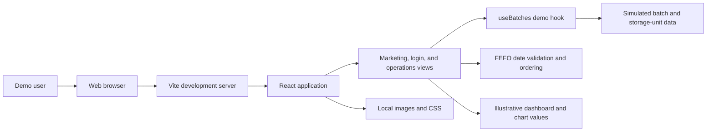
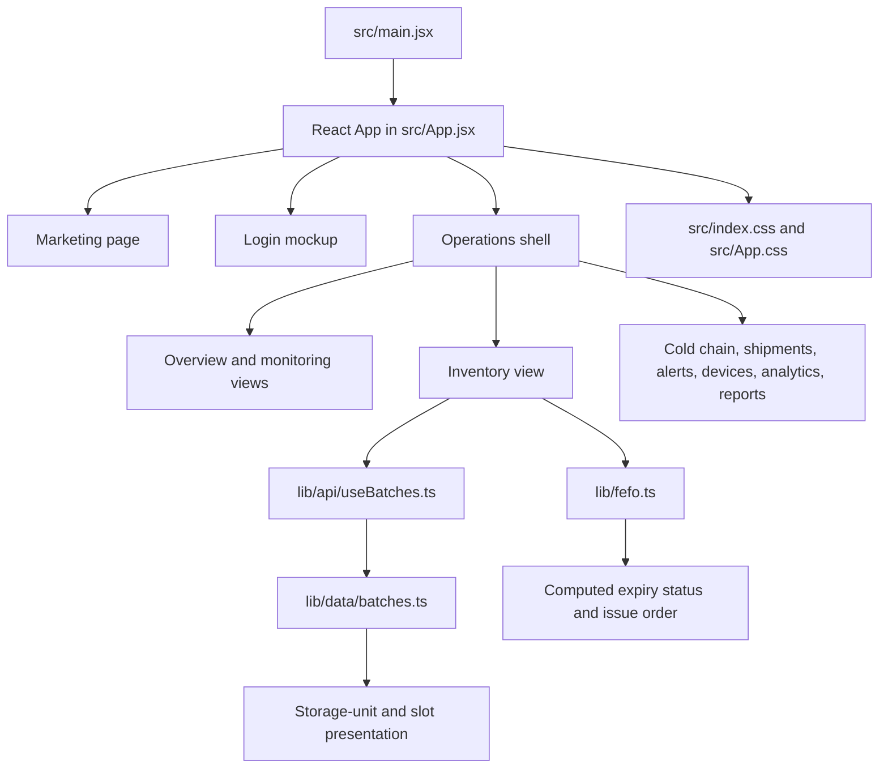

# VaxGuard Technical Design Document

## 1. Purpose and scope

VaxGuard is a browser-based React prototype for exploring vaccine cold-chain operations. It presents marketing and sign-in mockups plus an operations dashboard with monitoring, inventory, FEFO, storage-slot, shipment, alert, device, analytics, and report views.

The current implementation is a **frontend-only demonstration**, not an operational monitoring service. It has no backend, persistence, authentication, device integration, or live telemetry pipeline. Some screens display static illustrative values; the inventory and storage-unit records are local simulated data.

## 2. System context

For a production build, Vite emits static assets to `dist/`; a static web server can serve them. There is no application server in this repository.

## 3. Application architecture

### Main modules

| Module | Responsibility |
| --- | --- |
| `src/main.jsx` | Mounts the React application in the HTML root. |
| `src/App.jsx` | Contains page and view components, navigation, demo dashboard values, and inventory presentation state. |
| `lib/data/batches.ts` | Defines the `BatchRecord` shape, simulated batch seeds, storage units, and empty-slot lists. |
| `lib/api/useBatches.ts` | Provides batch/unit seeds to the UI. Despite its folder name, it does not issue network requests; `loading` and `error` are currently fixed to `false` and `null`. |
| `lib/fefo.ts` | Parses dates, validates date order, classifies expiry urgency, sorts batches, and assigns issue-order numbers. |
| `lib/fefo.test.ts` | Exercises FEFO ordering and date-boundary behavior with Node's test runner. |

## 4. Data model

The source type in `lib/data/batches.ts` is `BatchRecord`:

| Field | Type | Description |
| --- | --- | --- |
| `uid` | `string` | Unique demo record identifier. |
| `vaccineName` | `string` | Vaccine display name. |
| `batchNo` | `string` | Human-readable batch number. |
| `manufactureDate` | ISO date string (`YYYY-MM-DD`) | Manufacture date. |
| `expiryDate` | ISO date string (`YYYY-MM-DD`) | Expiry date used for FEFO ordering. |
| `quantityDoses` | `number` | Simulated dose count. |
| `dosesPerVial` | `number` | Doses in one vial. |
| `unitId` | `string` | Storage-unit identifier. |
| `slotId` | `string` | Slot identifier within the unit. |
| `status` | `ok`, `quarantined`, or `reserved` (optional) | Simulated storage/inventory state. |
| `source` | `simulated` | Identifies the seeded data as demo data. |

The `sample-data/sample-batches.json` fixture is a compact example of this shape.

## 5. FEFO behavior

`lib/fefo.ts` derives the FEFO fields for each batch:

1. Parse the manufacture and expiry dates; a record is invalid if either date is unusable or manufacture is not before expiry.
2. Calculate days remaining relative to the date passed to the FEFO helper. The inventory screen currently supplies a fixed demo date.
3. Assign an expiry urgency: expired; critical (0–7 days); high (8–30 days); normal (31–90 days); or low (more than 90 days). Invalid dates are reported as invalid.
4. Sort expired records first, then other valid records by ascending time to expiry. Ties are resolved by earlier manufacture date, smaller quantity, then UID. Invalid records sort after valid records and are ordered by UID.
5. Assign one-based issue-order numbers to valid, non-expired records. Expired records have no issue order.

The FEFO helper is a presentation/prioritization demonstration only. It does not account for cold-chain excursions, product-specific stability rules, jurisdictional rules, reservations, or a verified current clock, and must not be treated as safety or dispensing guidance.

## 6. Runtime and build

- **UI:** React 19, JavaScript/JSX, CSS, Tailwind CSS v4 utilities/plugin.
- **Build and dev server:** Vite 8.
- **Charts and icons:** Recharts and Lucide React.
- **Motion:** Framer Motion.
- **Tests:** Node.js built-in `node:test` and `node:assert/strict`.
- **Persistence/network:** None in the current application.

Local development and command instructions are in the repository [README](../README.md). There are currently no application environment variables.

## 7. Design constraints and production work

The current prototype intentionally uses local sample data and static presentation values. A production system would need separately designed and reviewed services for identity and role-based access, APIs and persistence, validated sensor ingestion, time-series storage, facility/device management, alert delivery, audit trails, data validation, backups, observability, and deployment. None of these services are implemented or implied by the current UI.

Before operational use, the domain rules, time zone behavior, thresholds, and workflow must be validated by qualified vaccine-program and cold-chain stakeholders. The app must not be connected to real patient or operational data without security, privacy, reliability, and regulatory review.
